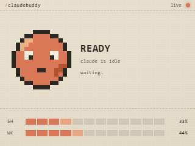
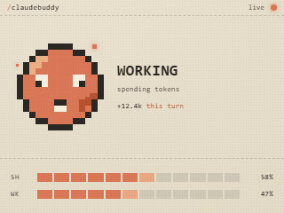

# claudebuddy

A desk companion for Claude Code on an **M5Stack Core2**. Shows your Claude API token usage in real time — how much of your 5-hour and weekly windows you've burned, whether Claude is actively working, and how long until the next reset.




## States

| State | What it means | Brightness |
|-------|---------------|-----------|
| **READY** | Connected, Claude is idle | 120 |
| **WORKING** | Tokens being spent | 255 |
| **MAXED** | Rate limit hit — big countdown to reset | 190 |
| **OFFLINE** | MQTT broker unreachable | 40 |

The screen sleeps after 5 minutes of idle and wakes automatically when you start talking to Claude (via a Claude Code hook), or when usage resets.

Hold **B** (middle touch button) to toggle dark / light mode. The preference persists across reboots.

## Hardware

- [M5Stack Core2](https://shop.m5stack.com/products/m5stack-core2-esp32-iot-development-kit) (ESP32, ILI9342C 320×240 LCD)
- Any always-on machine running Mosquitto and the daemon (a Raspberry Pi works well)

## Architecture

```
Claude Code (your machine)
  └─ UserPromptSubmit hook ──► MQTT clawdmeter/wake ──► wakes screen immediately

Raspberry Pi (or any server)
  └─ daemon/claude_usage_mqtt.py
       polls Anthropic API every 60s
       reads ~/.claude/.credentials.json (Claude Code OAuth token)
       ──► MQTT claudebuddy/state (retained)

M5Stack Core2
  └─ subscribes to claudebuddy/state + clawdmeter/wake
       renders warm-cream (or dark) UI
```

## Setup

### 1. Firmware

```bash
# Install PlatformIO, then:
cp src/config.h.example src/config.h
# Edit src/config.h with your WiFi credentials and MQTT broker IP

pio run -t upload        # compile and flash
```

### 2. Pi daemon

```bash
# On your Pi (or any always-on machine with Python 3.9+):
python3 -m venv ~/claudebuddy-venv
source ~/claudebuddy-venv/bin/activate
pip install paho-mqtt requests

# Copy your Claude Code credentials to the Pi, or run Claude Code there:
# ~/.claude/.credentials.json  (created automatically by Claude Code)

# Run the daemon:
python daemon/claude_usage_mqtt.py

# Or install as a systemd user service:
cp daemon/claudebuddy.service ~/.config/systemd/user/
systemctl --user enable --now claudebuddy
```

The daemon authenticates using the OAuth token Claude Code stores in `~/.claude/.credentials.json`. No API key needed.

### 3. Claude Code hook (optional — wake on prompt)

Adds a hook so the screen turns on the instant you submit a prompt, without waiting for the next 60-second poll.

Install `paho-mqtt` in the Python that `pythonw` resolves to:
```bash
pip install paho-mqtt
```

Edit `hooks/wake.py` and set the correct MQTT broker IP, then add to `~/.claude/settings.json`:

```json
{
  "hooks": {
    "UserPromptSubmit": [
      {
        "matcher": "",
        "hooks": [
          {
            "type": "command",
            "command": "pythonw \"C:\\path\\to\\claudebuddy\\hooks\\wake.py\""
          }
        ]
      }
    ]
  }
}
```

### 4. Agent board (one row per Claude Code session)

When any Claude Code session is active, the screen switches from the usage view to a list of agents: **NEEDS YOU** (amber, chimes and wakes the screen), **ERROR**, **WORKING**, then **DONE**. The header shows how many need you plus 5h/7d usage. The screen stays on while any agent is working or waiting on you, and sleeps 5 minutes after the last one finishes. With no agents it shows the usage view as before.

`hooks/agent_event.py` (standard library only, no `pip install`) publishes each session's state. Add it to `~/.claude/settings.json` in place of `wake.py`:

```json
{
  "hooks": {
    "UserPromptSubmit": [{ "hooks": [{ "type": "command", "async": true, "command": "python \"C:\\path\\to\\claudebuddy\\hooks\\agent_event.py\"" }] }],
    "PostToolUse":      [{ "hooks": [{ "type": "command", "async": true, "command": "python \"C:\\path\\to\\claudebuddy\\hooks\\agent_event.py\"" }] }],
    "Notification":     [{ "hooks": [{ "type": "command", "async": true, "command": "python \"C:\\path\\to\\claudebuddy\\hooks\\agent_event.py\"" }] }],
    "Stop":             [{ "hooks": [{ "type": "command", "async": true, "command": "python \"C:\\path\\to\\claudebuddy\\hooks\\agent_event.py\"" }] }],
    "StopFailure":      [{ "hooks": [{ "type": "command", "async": true, "command": "python \"C:\\path\\to\\claudebuddy\\hooks\\agent_event.py\"" }] }],
    "SessionEnd":       [{ "hooks": [{ "type": "command", "async": true, "command": "python \"C:\\path\\to\\claudebuddy\\hooks\\agent_event.py\"" }] }]
  }
}
```

Set `CLAUDEBUDDY_MQTT_HOST` if your broker isn't `192.168.1.125`.

| Hook | Board |
|------|-------|
| `UserPromptSubmit`, `PostToolUse` | WORKING |
| `Notification` (`permission_prompt`, `agent_needs_input`, `elicitation_dialog`) | NEEDS YOU |
| `Stop` | DONE |
| `StopFailure` | ERROR |
| `SessionEnd` | removed |

Rows age out: DONE after 30 min, ERROR after 1 h, a silent WORKING after 6 h (shown as QUIET after 30 min), NEEDS YOU after 12 h.

**Buttons:** A scroll up, C scroll down, B back to top, hold B to toggle dark mode, swipe to page. Any press wakes a sleeping screen.

Topic: `claudebuddy/agents/<session_id>` (retained)

```json
{"name": "Refactor auth", "state": "needs_you", "msg": "Claude needs your permission", "host": "dave-pc", "ts": 1763280000}
```

An empty retained payload removes the agent.

## UI design

The visual reference and all design assets live in `integration/`. Open `integration/Claude Desk Buddy.html` in a browser to preview all four states. The pixel mascot is defined in `integration/assets/mascot.json` and is swappable.

## MQTT payload reference

Topic: `claudebuddy/state` (retained)

```json
{
  "state":    "working",
  "h5_pct":   58,
  "wk_pct":   47,
  "reset_in": "1H 29M",
  "reset_at": "3:00p",
  "note":     "+13pt this poll"
}
```

`reset_in` and `reset_at` are only present when `state` is `maxed`. `note` is only present when `state` is `working`. The device decides `offline` itself when the MQTT link drops.

## Dependencies

**Firmware** (managed by PlatformIO):
- [M5Unified](https://github.com/m5stack/M5Unified)
- [ArduinoJson](https://arduinojson.org/)
- [PubSubClient](https://github.com/knolleary/pubsubclient)

**Daemon**:
- [paho-mqtt](https://pypi.org/project/paho-mqtt/)
- [requests](https://pypi.org/project/requests/)
